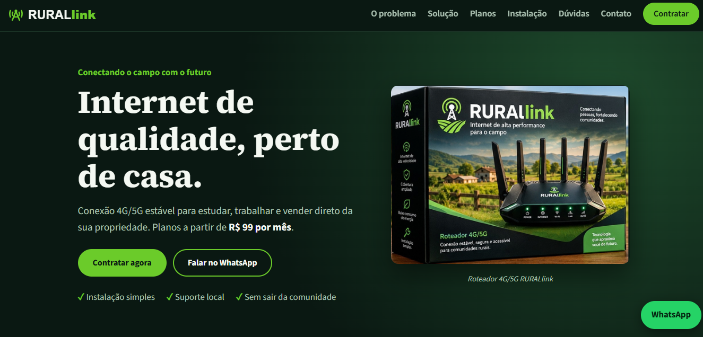
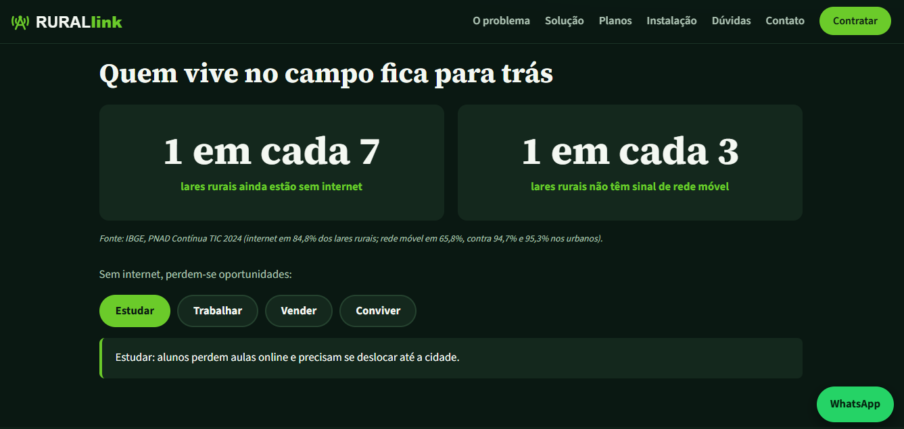
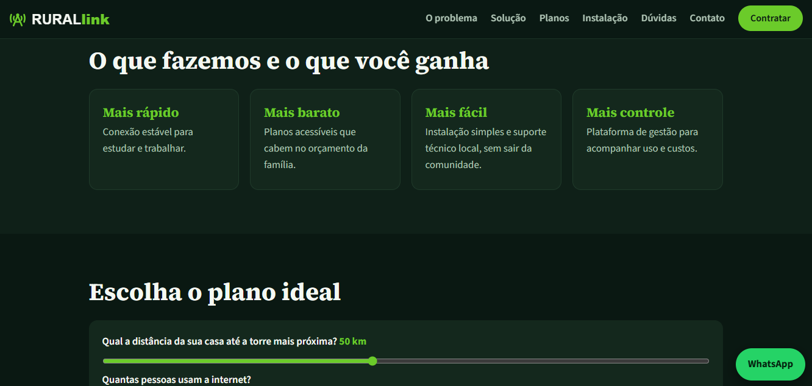
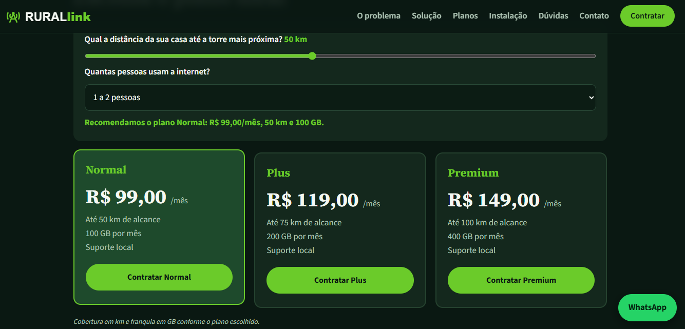
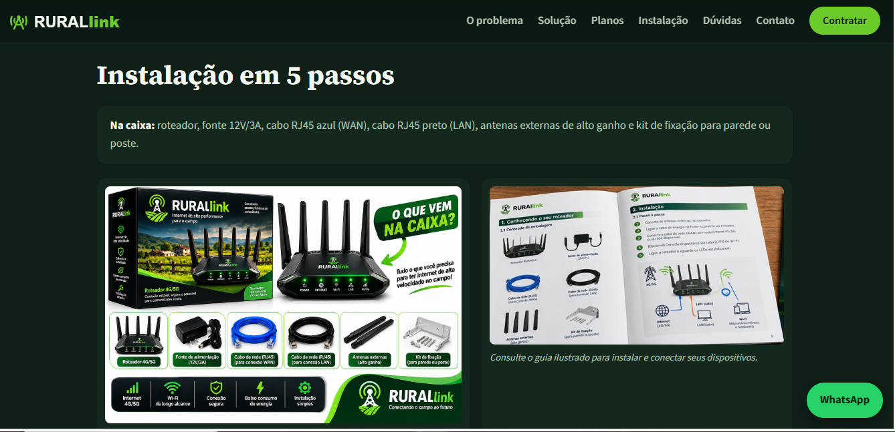
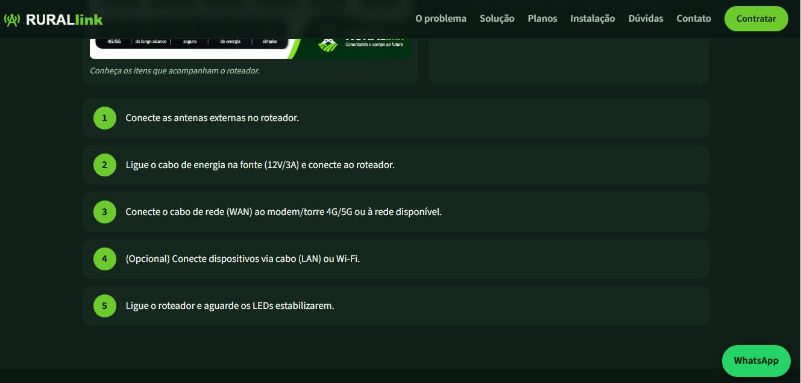
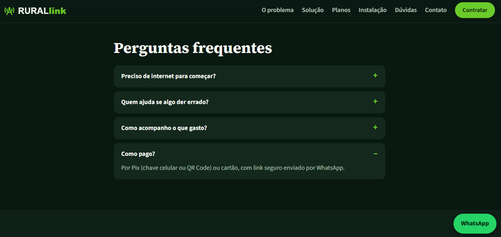
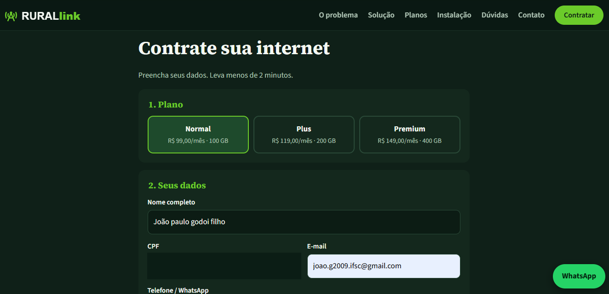
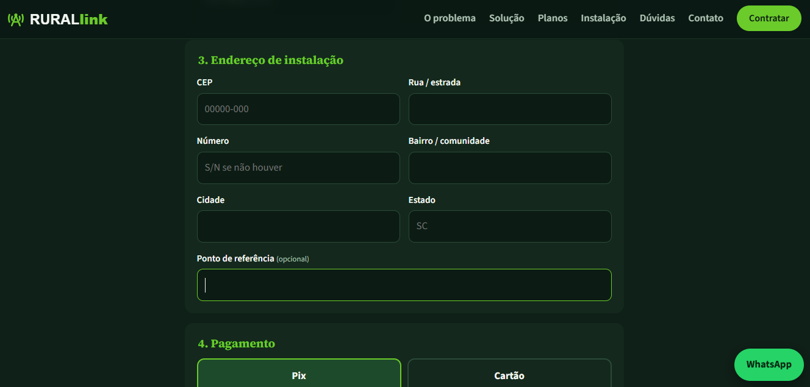
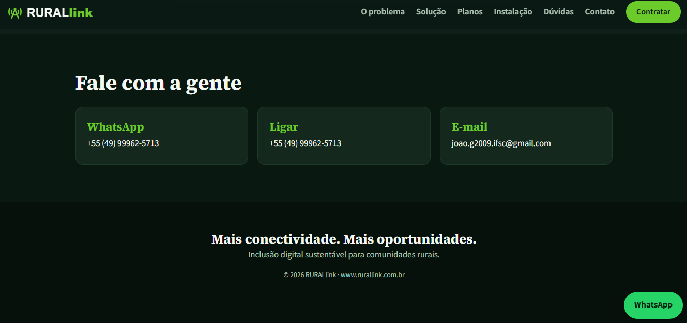

<div align="center">

# RURALlink

### Conectando o campo com o futuro.

**Uma proposta de inclusão digital para aproximar comunidades rurais das oportunidades do mundo conectado.**

[Visão geral](#visão-geral) · [Funcionalidades](#funcionalidades) · [Tecnologias](#tecnologias) · [Demonstração visual](#demonstração-visual) · [Como executar](#como-executar)

</div>

---

## Visão geral

A **RURALlink** é um projeto de desenvolvimento web que apresenta uma solução de conectividade voltada a moradores de áreas rurais. A proposta é facilitar o acesso à internet por meio de planos apresentados de forma clara, orientação de instalação e um fluxo de contratação simples.

O projeto foi desenvolvido com foco em **experiência do usuário, organização de conteúdo, responsividade e interatividade**, simulando a experiência de uma empresa que oferece internet para regiões afastadas dos centros urbanos.



## Problema e proposta de solução

Em muitas comunidades rurais, a conectividade ainda representa uma barreira para atividades cotidianas, como estudar, trabalhar, vender produtos e manter contato com outras pessoas.

A RURALlink apresenta uma proposta de serviço de internet 4G/5G para esse público. O site organiza as informações necessárias para que o visitante entenda a proposta, compare os planos, conheça os itens do equipamento e consulte as etapas de instalação.

## Funcionalidades implementadas

- **Apresentação institucional:** página inicial com identidade visual e chamada principal.
- **Seção do problema:** contextualização dos desafios de conectividade no meio rural.
- **Conteúdo interativo:** abas que demonstram impactos da falta de internet em diferentes atividades.
- **Recomendação de planos:** seleção baseada na distância informada até a torre e na quantidade de pessoas que utilizam a conexão.
- **Comparação de planos:** apresentação dos pacotes Normal, Plus e Premium.
- **Guia de instalação:** explicação visual dos itens da caixa e das etapas de instalação.
- **Perguntas frequentes:** seção de dúvidas comuns.
- **Formulário de contratação:** coleta de informações de contato e endereço de instalação.
- **Consulta de CEP:** integração com a API ViaCEP, conforme configuração do projeto.
- **Canais de atendimento:** atalhos para contato por WhatsApp e e-mail.

> **Observação:** os planos, preços e condições exibidos são dados demonstrativos do projeto. A contratação, disponibilidade de rede e cobertura precisam ser confirmadas pelo responsável pelo serviço.

## Planos apresentados

| Plano | Mensalidade | Alcance informado | Franquia |
|---|---:|---:|---:|
| Normal | R$ 99,00 | Até 50 km | 100 GB |
| Plus | R$ 119,00 | Até 75 km | 200 GB |
| Premium | R$ 149,00 | Até 100 km | 400 GB |

## Tecnologias

| Tecnologia | Aplicação no projeto |
|---|---|
| **HTML5** | Estruturação e organização do conteúdo. |
| **CSS3** | Identidade visual, layout, componentes e responsividade. |
| **JavaScript** | Interações da interface, lógica de recomendação e validações do formulário. |
| **ViaCEP** | Consulta de endereço a partir do CEP. |
| **QRCode.js** | Recurso para geração de QR Code, caso habilitado na implementação. |
| **Google Fonts** | Carregamento das famílias tipográficas utilizadas no layout. |

## Demonstração visual

Abaixo estão algumas telas do projeto. As demais capturas estão disponíveis na pasta [`assets/`](assets/).

### Página inicial


### Problema e solução



### Planos


### Instalação



### Perguntas frequentes e contratação




### Contato


## Estrutura do projeto

```text
rurallink/
├── index.html
├── style.css
├── script.js
├── README.md
└── assets/
    ├── screenshot.png
    ├── 01-inicio.png
    ├── 02-problema.png
    ├── 03-solucao.png
    ├── 04-planos.png
    ├── 05-instalacao-caixa.png
    ├── 06-instalacao-passos.png
    ├── 07-perguntas-frequentes.png
    ├── 08-contratacao-dados.png
    ├── 09-endereco-pagamento.png
    └── 10-contato-rodape.png
```

## Como executar localmente

1. Clone este repositório:

   ```bash
   git clone https://github.com/SEU-USUARIO/SEU-REPOSITORIO.git
   ```

2. Acesse a pasta do projeto:

   ```bash
   cd rurallink
   ```

3. Abra o arquivo `index.html` no navegador.

Não há etapa de compilação para a versão estática. Recursos externos, como fontes e consulta de CEP, dependem de conexão com a internet.

## Aprendizados e competências demonstradas

Este projeto reúne práticas importantes do desenvolvimento front-end:

- Estruturação de uma página com HTML semântico.
- Criação de identidade visual e layout responsivo com CSS.
- Manipulação do DOM e implementação de interações com JavaScript.
- Construção de formulários e validação de informações.
- Consumo de API externa para consulta de CEP.
- Organização de arquivos e recursos estáticos.
- Preocupação com clareza da navegação e experiência do usuário.

## Próximas melhorias

- Implementar uma API/back-end para processar e armazenar solicitações com segurança.
- Integrar um provedor de pagamento real, com confirmação de transações.
- Criar uma área administrativa para acompanhar pedidos e clientes.
- Adicionar testes automatizados e melhorar a cobertura de validações.
- Revisar acessibilidade e desempenho em diferentes dispositivos.

## Autor

**João Paulo Godoi Filho**

Estudante e desenvolvedor em formação, interessado em desenvolvimento web e criação de soluções digitais.

- GitHub: [@ManoJonasg](https://github.com/ManoJonasg)
- E-mail: joao.g2009.ifsc@gmail.com

---

<div align="center">

**RURALlink — Mais conectividade. Mais oportunidades.**

</div>
